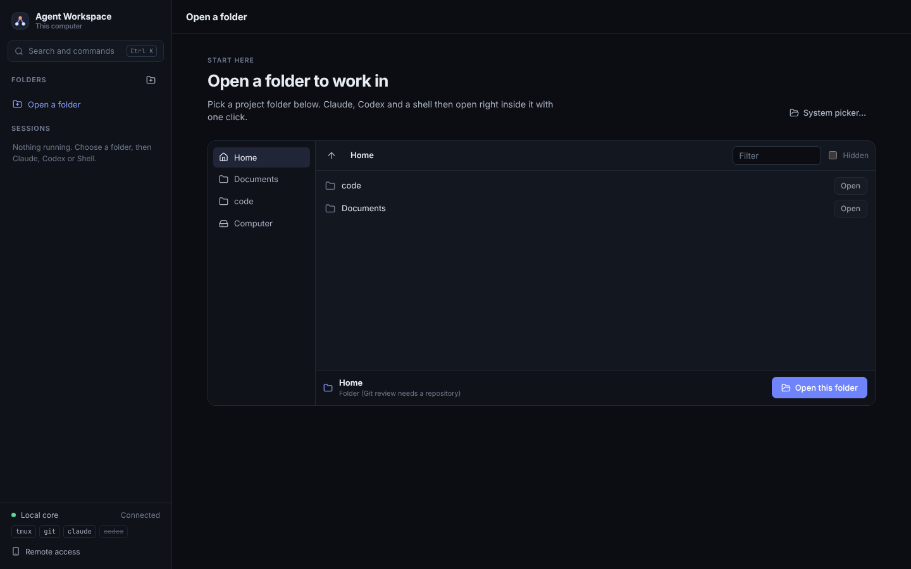

# Agent Workspace

An independently authored desktop and remote browser app for running coding agents. Pick a folder, click **Claude**, **Codex** or **Shell**, and work in a persistent terminal in that exact folder. Sessions keep running while you switch folders and views, and after you close the window. A spatial canvas, an optional task board, file editing and Git review live around those sessions. They are never a step you have to complete first.



Continuing development? Start with [docs/handoff.md](docs/handoff.md).

## Using it

1. **Open a folder.** Use the in-app browser (folders first, Git repositories marked, `⌘O` / `Ctrl+O`) or the system picker. Opened folders stay in the sidebar; **Remove from list** hides one without touching its files or history.
2. **Click Claude, Codex or Shell.** One click opens an interactive terminal in the folder shown under **Opens in**. Moving into a subfolder in the Files panel moves that target with it. Nothing is sent to an agent until you type. **Launch options** hold an optional model per provider (blank uses your CLI's own default), an optional first message (sent once, then cleared), and an existing worktree.
3. **Work with several sessions.** The sidebar lists every session across folders, with "needs you" first. Tabs above the terminal switch between sessions in the current folder. **Interrupt** sends Ctrl+C; **End** stops the process after confirming. Switching views or folders only detaches the view; it never restarts a process or resends a prompt.
4. **Name a session.** Click the pencil or double-click its title; Enter saves, Esc cancels, an empty name restores the default. Names are plain text (80 characters) and show in the sidebar, tabs and canvas.
5. **Paste a screenshot.** In the desktop app, **Paste image** (or pasting an image-only clipboard into a terminal) previews the image. Confirm saves it as a private PNG under the app's data folder (`attachments/<session>/`, owner-only permissions) and types its escaped path into the terminal without pressing Enter. Saved images are removed 7 days after their session ends. Remote browsers cannot read the host clipboard or upload images.
6. **Dictate.** In the desktop app, press **Dictate** in the session bar (or the microphone on a canvas terminal), or `⌘⇧Space` / `Ctrl+Shift+Space`, and speak English. Each phrase is typed into that terminal when you pause, through the terminal's paste path, with no Enter: you submit it yourself. The button shows a pulsing dot, the elapsed time and **Stop**. Switching sessions, a detached or ended terminal, or leaving the window stops dictation and releases the microphone; text that could not be typed is shown with **Copy**. Speech is recognised on this computer by an English Whisper model that you download once from **Voice dictation** in the sidebar footer (tiny, 118 MB, or base, 209 MB). The download comes from a fixed GitHub release address, is checked against a pinned SHA-256 and is stored under the app's data folder in `models/`. Audio stays in memory and is never saved or uploaded. Once you press Enter, the agent's CLI may send the text to its provider. Remote browsers have no dictation.
7. **Use the session board.** **Board** opens on **Sessions**: every session in the folder is a live card in one of the folder's lanes (**Up next**, **Working**, **Review**, **Done** to start). A card shows its provider, name, status (Working, Needs you, Done, Running or Ended), location, model and last activity; Needs you cards stand out and ended ones are dimmed with **Resume** (a cleanly ended Claude conversation) and **New here**. A session you have not filed shows in Working while it runs and in Done once it ends. Drag a card to another lane, or use **Move to…** on any card (keyboard and touch); moving only records the lane and never restarts, detaches or types into the process. **+** on a lane starts Claude, Codex or a shell straight into it. Double-click a lane name (or use its **…** menu) to rename it; a folder can have up to six lanes, and only an empty lane can be removed. Click a card to open its live card: the real terminal, rename, lane picker, Interrupt/End and Resume/New. Closing it (or Esc outside the terminal) only detaches that view. Ended cards beyond the 20 most recent in a lane wait behind **Show more**. On a phone the lanes scroll sideways and a card opens full-screen. **Tasks** switches to the task board.
8. **Let an agent use the canvas.** In the desktop app, **Agent control** in a running session's bar (or its live card) lets the program in that terminal run `awctl`. Choose what it may do (read status, create notes, edit notes, move canvas cards, and, off by default, open sessions) and how long the grant lasts (60 minutes by default); opened sessions are limited to 3 running at once by default. The button then reads **Agent control on**, and its dialog lists recent agent actions with **Revoke**. Inside the session:

   ```sh
   awctl status                                   # this folder's sessions, notes and canvas layout (JSON)
   awctl note create --title "Plan" --body-file plan.md
   awctl note update --note <id> --revision <n> --body "..."
   awctl canvas place --node <id> --x 800 --y 120 --revision <layout revision>
   awctl open --provider shell --path src --request-id <your id>
   ```

   Every answer is one JSON object with durable IDs and revisions. Exit 0 means done, 1 refused (nothing changed), 2 usage error and 3 outcome unknown: run `awctl status`, then retry with the same `--request-id`, which never repeats a create or open. A note or layout edit made with an old `--revision` is refused, so the agent never overwrites your newer edit. Agent notes are plain text marked **AGENT NOTE**. Sessions the agent opens start with no first message and get no control of their own. `awctl` cannot type into terminals, end sessions, change files or Git, change settings, add folders or grant itself more. Quitting the app (or a core restart) revokes every grant; there is no automatic regrant. Remote browsers cannot grant control. Only sessions opened by this version can be granted, because each new session is told at launch where its grant file would be (`$AW_CONTROL_FILE`, with `awctl` on its `PATH` and in `$AWCTL`). macOS and Linux only (a Unix socket); not available on Windows. Other programs running as your user could read a grant while it lasts: this limits what an agent may ask the app to do; it is not a sandbox.

9. **Get AI suggestions (optional, off by default).** In the desktop app, open **AI suggestions** in the sidebar footer, choose Claude (or Codex, see below), optionally a model, and confirm the notice: what you preview is sent to that provider through your own installed CLI and sign-in, and may use your plan's usage or API credit. Then **Suggest message** next to the commit box (Changes) previews exactly the text that would be sent: the staged diff only (never unstaged or untracked files), no binary contents, capped at 60 KB, with every left-out file listed; untick a file to leave it out. **Generate draft** makes one request and puts an editable draft in the commit message box. Nothing is staged, committed or pushed for you. If the staged changes change afterwards, the draft is marked stale (and Commit asks first). **Suggest name** in a session's rename field lets you tick the context to share (task title and description, the session's first message, the folder name; never terminal output), previews it, and **Accept name** saves it through the normal rename. The CLI runs from an empty private folder with the previewed text on stdin, a reduced environment, tools, MCP servers, hooks and customizations turned off (`claude --print --safe-mode --restricted --tools "" --disallowedTools "mcp__*" --strict-mcp-config` with an empty MCP config, `--permission-mode dontAsk --permission-prompts none --no-session-persistence --disable-slash-commands --no-chrome --output-format json`), a 60 second limit and no automatic retry. The app checks the installed CLI's `--help` for every one of those flags and shows Claude as unavailable if any is missing. Codex is offered only when its help lists every read-only flag the adapter uses, and is then marked "isolation unverified". Remote browsers have no AI suggestions.

10. **Work on another computer over SSH.** In the desktop app, open **SSH hosts** in the sidebar footer and add a host alias from your own OpenSSH configuration (optionally a user, port, helper folder and helper data folder). **Add and check host** runs the system `ssh` client and shows what the host has: the helper version and protocol, and whether Node, tmux, Git, Claude and Codex are installed there. A host whose key is not in your `known_hosts` (or whose key changed) is refused and its SHA256 fingerprint is shown; compare it out of band, then accept it yourself with `ssh <alias>` in your own terminal. The app never accepts or writes host keys, never stores passwords or keys, and cannot answer password prompts (use keys or your SSH agent). **Connect**, then **Open a folder…** to browse the host and add one of its folders. It appears in the sidebar with the host's name, and Claude, Codex, Shell, Files, Changes, the board and the canvas all work on that host, with the host's own PATH and CLI sign-in. The footer shows each host as Connected, Reconnecting or Disconnected. If the connection drops, the app reconnects by itself and your open terminals reattach to the same sessions; **Disconnect** (or quitting the app) leaves them running on the host, and while disconnected they show as unknown. Anything sent just before a drop (a launch, a save) is reported as "outcome unknown" and is never resent: check, then retry (a retried launch returns the same session). Pasted images, agent control and AI suggestions are not available for SSH sessions, keep-awake only counts local sessions, and SSH folders are never shared with paired browsers. Dictation still works: your speech is recognised on this computer and only the text is typed into the remote terminal.

   **Install the helper on the host** (once per host and app version; nothing is installed for you): install Node.js 24+, tmux and Git there, copy `agent-workspace-server-<version>.tar.gz` (from `npm run package:server`) to the host and run `tar -xzf agent-workspace-server-*.tar.gz && mv agent-workspace-server-<version> ~/agent-workspace-server && cd ~/agent-workspace-server && npm ci`. The app then runs exactly `ssh -T <alias> <helper folder>/bin/aw-ssh-helper [--data-dir <folder>]` with batch mode, strict host key checking, no agent, X11 or port forwarding, no connection sharing, a 15-second connect timeout and keepalives; folders, prompts and branches never appear in that command. The helper keeps its own data in `~/.agent-workspace-ssh` (or the folder you chose), separate from any standalone server on the host. If Node 24 is not on the host's non-interactive PATH, set `AW_NODE` for it (for example with the host's sshd `SetEnv`, or by editing `bin/aw-ssh-helper`).

11. **Work with a team (optional).** Someone in your organization runs the self-hosted team service, set up with your own identity provider; see [docs/team-service.md](docs/team-service.md). In the desktop app, choose **Team** in the sidebar footer, then enter the service address and the invitation code you were sent. **Connect** opens your browser to sign in; there is no public sign-up.

   - **Share tasks.** A team owner or project admin publishes the open folder. Publishing sends nothing by itself. To share a task, open it on the Board's **Tasks** view and choose **Share with team…**. You see exactly what leaves this computer, which is only the title, description and status: never paths, prompts, transcripts, terminals or files. Later local edits wait until you choose **Update shared copy…**.
   - **Comment and assign.** In the task sheet, or in a team project in the Team panel, people comment in plain text and edit or delete their own comments. They also pick an assignee: admins can assign any active project member, and members can take an unassigned task. An assignment is only coordination. It gives nobody access to your terminals, files or computer.
   - **Read the board.** Cards show the assignee, the comment count and the sync state: **Shared**, **Sending…**, **Conflict**, **Local edits not shared**, **Access ended** or **Offline**.
   - **Work offline.** Comments and assignments you make offline wait in a visible list and are sent once. A change that conflicts with a newer one is shown for you to apply again or discard, never merged silently.
   - **Manage members.** In a team project, admins invite people with a role (member, viewer or admin), change roles and remove people. Removing someone ends their access and assignments at once, and their app deletes its copy of that project's data at its next sync.
   - **Credentials.** Your team sign-in is kept only in the operating system's secret storage. On a Linux desktop without an unlocked keyring, team sign-in is turned off rather than stored in plain text. Team sign-ins cannot use remote access, agent control or the local core.
   - **Disconnect.** **Disconnect** removes this computer's copy of team data and leaves your local tasks.

Claude sessions report **Working**, **Needs you** and **Done**. Each one is launched with its own `--session-id` and a per-session `--settings` hook that records its turn state; your global Claude configuration is not changed. You get an in-app notice, plus an OS notification when the window is in the background, when a session needs you, finishes its turn, or exits unexpectedly. Codex and shell sessions show running or ended.

**Keep awake while agents work** (sidebar footer, desktop only, off by default) stops this computer from suspending while at least one local Claude session reports it is working. The display can still sleep. Each hook report is time-stamped and trusted for 20 minutes; needs you, done, exit, an unreachable core, turning the setting off or quitting the app releases it, so a silent turn longer than 20 minutes can let the computer sleep. Codex and shell sessions cannot report work and never keep it awake.

When a process ends on its own, its last screen and exit status are kept, so a CLI that fails at startup (not signed in, unknown model) shows its own error. An ended Claude session can **Resume conversation** (`claude --resume`), including after a reboot. **New … here** starts a fresh one in the same folder. For Codex, **Resume…** opens Codex's own resume list; this path has not been tested.

If a CLI isn't found, its button says so and offers install guidance, **Check again** and **Open a Shell here**. The desktop app reads your login shell's PATH, so CLIs installed through nvm, Volta or Bun are found.

The **Board** (live session cards in lanes, plus a **Tasks** mode with task status and task attempts in optional isolated worktrees) and **Canvas** (sessions and notes as movable nodes; right-click to add Claude, Codex, a shell or a note) are optional views of the same sessions.

## Run

Requires macOS, Node.js 24+, Git, and tmux (`brew install tmux`). Development and the automated checks also run on Linux with tmux and a UTF-8 locale. Claude and Codex commands use your existing installed CLI authentication. The app never installs providers or changes their global configuration.

```sh
npm ci
npm run dev
```

`npm run build` creates the renderer and Electron entrypoints. `npm run typecheck` checks TypeScript. `npm test` runs the integration tests. `npm run package` creates an unsigned internal macOS application and zip in `release/`. Open the application in `release/mac-arm64/Agent Workspace.app` on Apple silicon. Build on the target architecture.

Before upgrading an existing workspace database, the app saves a consistent copy to `backups/workspace-v<old version>-<time>.sqlite` in its data folder and keeps the newest three. To roll back, quit the app, replace `workspace.sqlite` with that copy and delete `workspace.sqlite-wal` and `workspace.sqlite-shm`, then run the matching older build. A database written by a newer version is refused unchanged.

## Remote browser access

In the desktop header, choose **Remote access**. Access starts off and remains off after each app restart. Keep the default loopback listener for an HTTPS tunnel, or choose network interfaces with a browser-trusted TLS certificate and private key through the native pickers. A network listener requires its exact HTTPS browser origin. Enable the gateway, open the displayed address on your other device, and reveal the pairing code locally to pair it. **Revoke all devices** closes active browser connections and rotates the code; **Stop remote access** detaches browsers while terminal processes continue.

Paired devices can control terminals and edit files in the projects registered when the gateway started. Stop and enable remote access again after adding a desktop project to include it. Browser authentication expires after 12 hours or when the gateway restarts. Keep the host awake and app running. For access anywhere, configure your own HTTPS private-network proxy, such as [Tailscale Serve](https://tailscale.com/docs/features/tailscale-serve), to forward to the loopback listener with WebSocket support and preserved Host/Origin headers. This app does not install external services or publish a public endpoint. The browser origin must match the configured public address exactly. The source package's [standalone server guide](docs/server-README.md) includes the host and HTTPS setup.

For a separate Mac or Linux server, extract `release/agent-workspace-server-<version>.tar.gz`, then run `npm ci` and `npm start -- --data-dir /absolute/path/to/data --project /absolute/path/to/git-project --host 127.0.0.1 --port 8787`. This distribution includes browser assets and its own Node-only package lock; it has no Electron install or rebuild hooks. `npm run package:server` recreates it. Native dependencies install on the destination host, which requires Node 24+, Git and tmux. Do not run desktop and server cores against the same data directory. The same archive is the SSH helper (`bin/aw-ssh-helper`, see **Work on another computer over SSH** above).

To run the host from source, use `npm run build:server`, `npm run rebuild:server`, then `npm run start:server -- --project /absolute/path/to/git-project`. Use `npm run rebuild:desktop` before returning to Electron if you changed the native build. The standalone archive installs its native dependency for Node directly.

The responsive browser has a folder and session drawer, bottom navigation, the same one-tap Claude/Codex/Shell launch inside shared folders, a terminal command bar, and installable PWA metadata. Browser install support depends on platform and HTTPS. The open app shows connection status and reattaches when the host returns. A fresh offline launch is not supported. Physical iPhone/Android hardware and external network routes have not been verified in this release.

## Persistence and recovery

The workspace database uses schema version 2 from 0.3.0, version 3 for owner settings and pasted images, version 4 (`board_lanes`) for session-board lanes and card placement, version 5 (`roadmap_04_controller`) for note and layout revisions and the agent-control audit trail, and version 6 (`roadmap_03_execution_hosts`) for SSH hosts and a cached list of their folders (the host's own helper data stays authoritative), and the next number, `roadmap_05_team_metadata`, for the team link, mappings, a bounded cache of shared task metadata, sync cursors and the unsent-changes outbox (never team tokens). Each migration keeps existing records, and older builds refuse to open newer data.


The Electron renderer is sandboxed and has no Node integration. A narrow preload forwards named workspace commands to a separate utility process. Metadata is kept in SQLite under Electron's application data directory. Terminal processes live in tmux on a private application socket: closing a view detaches it, and explicitly quitting the app stops its core without terminating tmux sessions. Reopening reconciles those sessions. A reboot ends live processes; history remains.

The app permits a single desktop instance. If the core crashes, the desktop makes up to three reconnection attempts. An interrupted command can have an unknown outcome; inspect state before retrying a mutation.

## Alpha scope

Execution stays on the selected host. A browser on a phone or another computer can control registered projects through an explicitly enabled authenticated gateway. Terminal output can contain sensitive information and is visible to paired devices. Provider terminals do not imply structured approval handling, conversation resume, usage accounting, or multi-user collaboration. Agent execution uses the same permissions as the desktop user. Terminate a session deliberately from the interface when it should stop.

The internal build is unsigned and has no updater. Packaging and runtime test evidence belongs in `docs/release-evidence.md`.

## Verification

The local fixture runners use disposable repositories and isolated app data. `npm run smoke` checks the desktop/core bridge; `npm run smoke:ui` checks visible controls, editor saving and native close cancellation. `npm run verify:desktop` tests IPC rejection and the bounded core restart policy. `npm run verify:workflows`, `npm run verify:board`, `npm run verify:lifecycle`, `npm run verify:keep-awake` and `npm run verify:terminal` exercise the remaining UI workflows and terminal fidelity. `npm run verify:dictation` checks local voice dictation. `npm run verify:agent-control` grants a shell agent control and drives `awctl` from inside it. `npm run verify:ssh` starts a disposable local `sshd` (its own keys and config in a temp folder; needs OpenSSH's `sshd`) and drives an SSH host end to end: unknown host key, probe, connect, a remote folder, a remote shell across a killed connection, a remote file edit and Git status. Set `WORKSPACE_VERIFY_SSH_ARCHIVE` to a server archive to install the helper from it with `npm ci` instead of from this build. `npm test` includes SSH tests that use the same kind of disposable `sshd` and skip when it is not installed. `npm run verify:remote-desktop` checks remote authentication, the shared desktop utility core and shell identity, revoke, gateway shutdown and core recovery. `npm run verify:mobile` checks responsive browser workflows with installed Chrome; `npm run verify:mobile-webkit` uses a Playwright WebKit installation for the HTTPS touch fixture. `npm run verify:server-release` installs and tests a fresh standalone archive outside this checkout. `npm run verify:linux-server` tests the archive in an isolated, unprivileged Docker Linux host with loopback-published HTTPS; use `WORKSPACE_DOCKER_HOST` if Docker needs an explicit connection. Build before running them. Set `WORKSPACE_APP_EXECUTABLE` to an application executable to run the same checks against a packaged copy. `npm run verify:team` starts a local fake OIDC issuer and a team service, then drives two desktop instances: the owner connects, publishes a task after its preview, invites a member, the member comments and takes the task, and the owner removes the member, whose copy of the project is then purged. It needs only Node and Electron, no external services. `npm run verify:assist` checks AI suggestions with a fixture `claude` (no provider is called); `WORKSPACE_TEST_REAL_ASSIST=1 npm test` adds one opt-in real Claude request that can use your usage.

`npm test` includes a folder-launch test that uses fixture CLIs in real tmux. It covers blank interactive launch, folder isolation, an idempotent retry, hook-driven needs-you status, saved startup-failure output and resume. Browser scripts accept `WORKSPACE_BROWSER=/path/to/chromium` instead of installed Chrome. `npm run make-icons` regenerates the app and browser icons from the brand mark. Current verification evidence is in [docs/release-evidence.md](docs/release-evidence.md).

`npm run verify:dictation` drives dictation with Chromium's fake microphone playing a WAV synthesised by `espeak-ng`. By default it installs the real tiny.en model through the settings dialog. Set `WORKSPACE_TEST_DICTATION_ARCHIVE` to a local copy of the release asset to skip the network (the pinned checksum still applies), or set `WORKSPACE_VERIFY_DICTATION_FIXTURE=1` to use a fixture transcriber. `WORKSPACE_TEST_REAL_DICTATION=1 npm test` adds an opt-in test that installs tiny.en and transcribes a synthesised clip.

Dictation uses these third-party components:

- `sherpa-onnx-node` 2.0.1 and its per-platform `sherpa-onnx-<os>-<arch>` packages (Apache-2.0). These are prebuilt N-API addons that include ONNX Runtime (MIT).
- `unbzip2-stream` 1.4.3 (MIT), with `through` (MIT), `buffer` (MIT), `ieee754` (BSD-3-Clause) and `base64-js` (MIT).
- Speech models (downloaded, not bundled): OpenAI Whisper `tiny.en` and `base.en` weights (MIT). They were exported to int8 ONNX by the k2-fsa sherpa-onnx project and are published in its `asr-models` GitHub release.

`npm run verify:providers` starts real Claude and Codex calls using existing authentication and can consume provider usage. It is a separate opt-in check. `WORKSPACE_VERIFY_MODELS` accepts a JSON object with `claude` and `codex` model IDs; `WORKSPACE_VERIFY_PROVIDERS` selects a comma-separated subset. The provider fixture checks exact file edits, an append-only execution count, and unchanged session generations and provider process IDs across application quit/reopen. Prompts are sent once per new attempt. Model fields start blank, which inherits the installed CLI default; the tested models `claude-opus-4-6` and `gpt-6.1-sol` are offered as suggestions.

`npm run verify:remote-provider` is a separate opt-in check that launches one real Codex `gpt-6.1-sol` task through the authenticated browser gateway using existing host authentication. It can consume provider usage and is outside the ordinary test gates.
