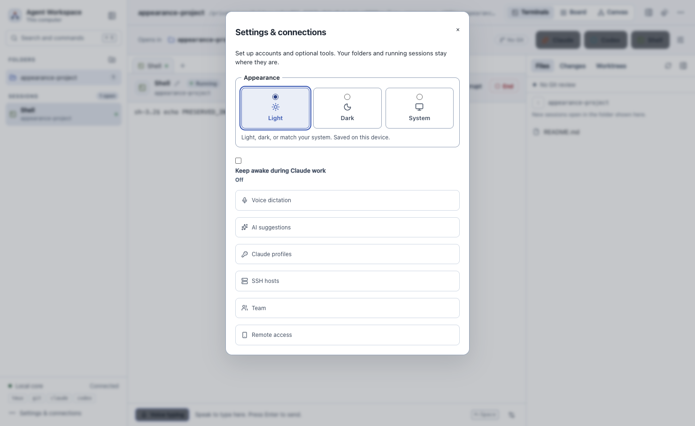
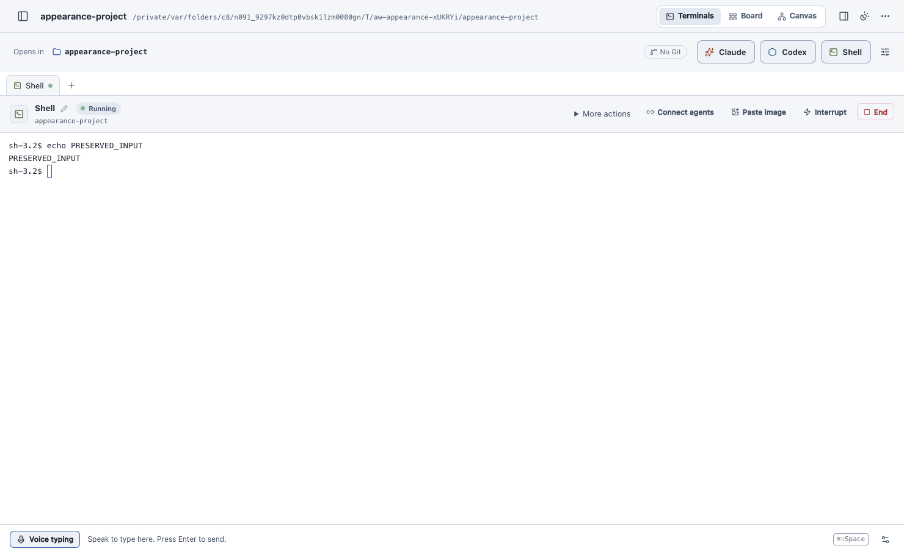
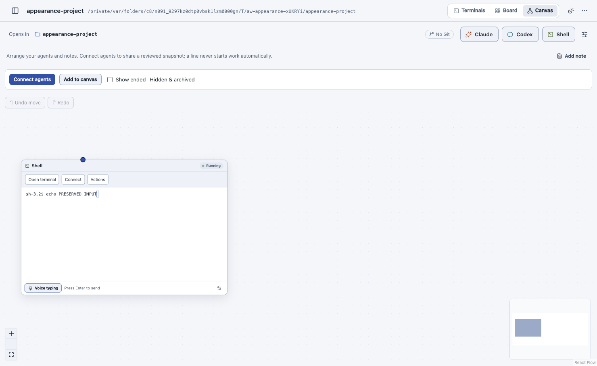

# Layout and appearance — 0.4.3

Verified 2026-11-03 on macOS arm64, branch `codex/ux-repair`.

The folders/session sidebar previously had no desktop collapse action. Files could be hidden only from the top toolbar, and hiding an open editor unmounted it. App, terminal, editor and Canvas colors were fixed to dark palettes.

## Behavior

- The left sidebar has a collapse button beside the app name, with a restore button at the top-left of the workspace.
- Files has a collapse button beside Refresh, and open editors have one in their header. The top toolbar restores the panel. The panel stays mounted while hidden, preserving its tab, selected file and unsaved text. Normal navigation/quit still guards unsaved edits.
- Both collapse choices persist across reopening. The terminal uses the freed space. Expanded editors also adjust to the sidebar width.
- **Appearance** in Settings offers native radio controls for **Light**, **Dark** and **System**. The top toolbar's sun/moon button opens these settings, including when the sidebar is collapsed. Command search finds appearance and sidebar actions.
- The theme covers shell surfaces, dialogs, status colors, terminal background/default ANSI palette, Monaco, Canvas nodes/edges/controls and the minimap. Xterm updates in place, with light-mode minimum text contrast enabled; neither theme changes nor panel collapse restart terminals. CLI-specific colors remain controlled by the CLI.
- Appearance is saved locally per device. System mode reacts to preference changes; explicit Light/Dark choices override them. A local startup script applies the stored theme before the first paint without changing the content security policy.
- Narrow layouts keep their folder drawer and Files/Terminal navigation independent of the desktop sidebar's saved collapse choice.

## Verification

- TypeScript and macOS packaging passed.
- Automated suite: **128 total, 126 passed, 0 failed, 2 opt-in skips**.
- Packaged appearance regression: **6 checks passed**. Both collapse/restore paths, larger terminal bounds, focus return, unchanged terminal DOM and process identity, unsent input, unsaved editor restoration, Monaco theme changes, expanded editor placement, Canvas theme changes, quit/reopen persistence and a 390-pixel responsive layout were exercised. [Machine-readable results](screenshots/appearance/verification.json).
- Packaged smoke: **9 checks passed**, including real shell input, core crash recovery, cancelled dirty-editor quit, Canvas and editor saving.
- Five fixture screenshots were visually inspected. The final capture waits for Canvas output and the mobile drawer animation to settle.
- The actual installed app was opened, switched to Light mode, and both collapse controls were exercised on the owner's current workspace. No prompt was submitted to an existing terminal.

System mode was tested using emulated color-scheme changes. Narrow-layout checks used a resized Electron window; no physical phone or external remote deployment was tested in this change. Fixtures used a local shell and disposable files, with no paid provider calls.

## Installed update

The existing app directory was updated to **0.4.3**. Consistent database backups and the previous 0.4.2 app contents remain under `release/upgrade-backups/0.4.3-appearance/`, ignored by Git.

- Schema remains 9.
- **All 45 saved records preserved.**
- **All four live terminal processes retained their original PIDs**, identity, generation and working folder.
- ZIP contents match the installed `app.asar` byte for byte.
- The unrelated November 3 audit and its ten screenshots were hash-verified unchanged and excluded from this commit.

| Artifact | SHA-256 |
| --- | --- |
| `release/appearance-0.4.3/Agent Workspace-0.4.3-arm64-mac.zip` | `bed380d4e056e601871796608bb26483d5bd64c133fad7c5f24ed37ca7a070cc` |
| Installed `app.asar` | `fd400d2e4c1de521f1b08c410bea9640837826af0b5ef24b111e3f1a4b5ecc49` |

