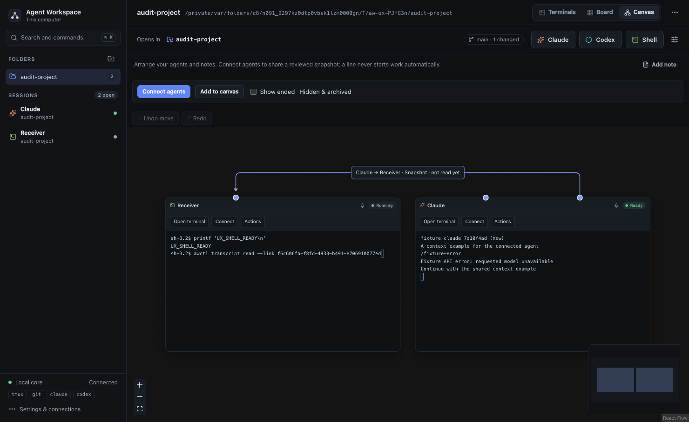
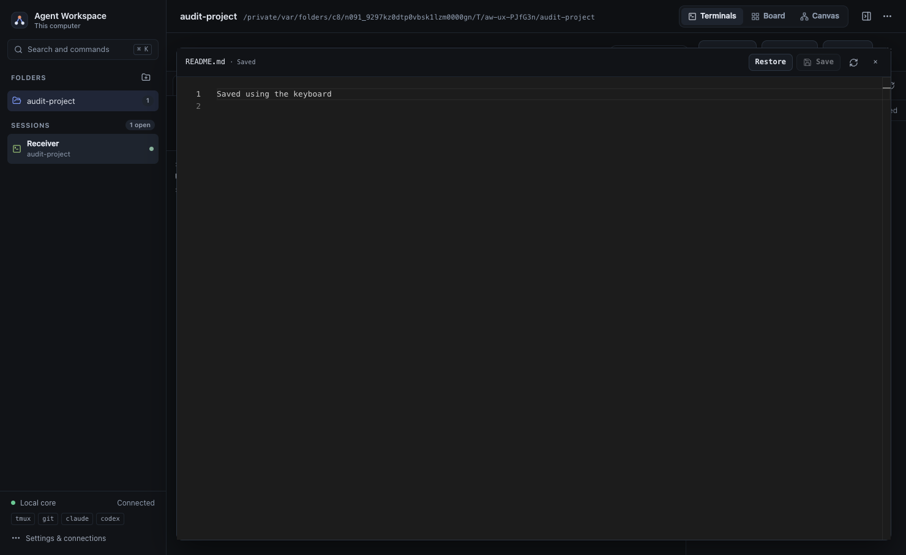

# Agent Workspace 0.4.0 verification evidence

For later verification, see [0.4.2 transcript connections](transcript-connect.md) and [0.4.1 voice typing](voice-typing.md). This page preserves the 0.4.0 audit evidence.

Date: 2026-11-02 (America/Toronto), following the November 1 audit. The macOS arm64 app was packaged, exercised in disposable workspaces, installed over the existing local app, and opened successfully. See [the finding-by-finding repair map](ux-repairs.md) and [machine-readable results](screenshots/ux-repairs/verification.json). Earlier evidence is retained in [release-evidence-0.3.0.md](release-evidence-0.3.0.md).

## Verification

Host tools: Node 24.12.0; packaged Electron 45.1.0; macOS arm64. Providers in the test suites are fixtures; no live model-generation call was made. No subagents were used for these repairs.

| Gate | Result |
| --- | --- |
| TypeScript | Passed |
| Automated tests | 128 total: 126 passed, 0 failed, 2 opt-in skipped |
| Packaged UX regression | 14 workflow checks passed, including a saved legacy canvas layout, connect/read/revoke/renew, explicit instruction insertion without Enter, failed-turn UI, note restore, editor keyboard save, task attachment and selected-folder sharing |
| Packaged lifecycle | 6 checks passed: reconnect, final output, End, focused note autosave, cancelled close, persistence through quit/reopen |
| Packaged desktop smoke | 9 checks passed: shell, board, canvas, editor and crash recovery |
| Desktop recovery/IPC | 4 checks passed, including repeated real core crashes and same persistent session/generation |
| General workflow regression | 15 checks passed, including drag, note moves, conflicts, staging, commit, worktrees and non-Git folders |
| Session board | 10 checks passed |
| Agent control | 10 checks passed, including permission refusal, scoped commands, child isolation, revoke and unchanged PIDs |
| Profiles / branches / transcript links | 10 fixture checks passed, including redaction and cross-profile consent |
| AI suggestions | 6 fixture checks passed; no paid calls |
| Team flow | 8 checks passed with two app instances, a fake issuer and ephemeral test credential storage |
| Remote desktop/browser | 7 checks passed: pairing, scope, real shell, reconnect, revoke and default-off restart |
| Terminal fidelity | 7 checks passed, including Unicode, alternate screens, a 10,000-line burst and backpressure/resync |
| Keep awake | 9 checks passed against Electron's blocker API and fixture Claude hooks |
| Packaged SSH + fresh server archive | 10 checks passed on a disposable real OpenSSH server: host-key refusal, probe, connect, folder navigation, shell, connection loss/recovery with the same PID, file edit, Git and detach |
| Standalone archive installation | Fresh `npm ci`, browser pairing, real shell, SSH helper handshake and owner-command refusal passed outside the checkout; team service and its setup guide are included |

The last packaged UX run was repeated after the initial-fit correction and passed all 14 checks. Actual user data was then reopened and its canvas visually inspected; preserved cards fit automatically without moving their stored positions.

## Actual upgrade proof

The installed app remains at the same filesystem location, preserving the application directory identity. Consistent database backups and the previous app contents were kept locally under `release/upgrade-backups/` (ignored by Git).

- Database migrated from schema 8 to 9.
- 35 records before and after; no record IDs missing.
- No changes to existing session identity, generation, project, working directory, backend name or socket.
- Both originally running sessions retained their actual tmux pane process IDs.
- The updated app opened with its local core connected. No existing agent prompt was submitted or replayed.
- The existing failed Claude turn now shows **Check terminal**, because an older CLI process cannot retroactively emit the newly added failure hook. The owner can inspect it and use **More actions → Mark turn idle…**. Its billing/model selection was not changed.

## Artifact fingerprints

| Artifact | SHA-256 |
| --- | --- |
| `Agent Workspace-0.4.0-arm64-mac.zip` | `d0ebdc6e76cf6efdbd81eef9a57726714b883b8eeb9147fe093e5d11a41e77f7` |
| Installed `app.asar` | `4a27a9aa03a02976514314f267c9870715747cecabaaffafcb503bf78928d680` |
| `agent-workspace-server-0.4.0.tar.gz` | `7b8b5a9a5784295162131e804399c309d11ba4bb77544fa4ce956348d4451e62` |

## Screenshots

The screenshots in [screenshots/ux-repairs/](screenshots/ux-repairs/) come from the packaged test app with disposable data and fixture providers. They were visually inspected. They are not captures of the owner's private conversations.

## Limits

The app is unsigned/not notarized. No physical-phone, microphone-recognition, real two-account isolation, production identity-provider/TLS deployment, or live paid-provider turn was claimed from these checks. Those environments still require the owner's setup. The two skipped automated checks explicitly opt into real Claude usage and real-model dictation.

System credential storage is checked only on an explicit Team setup action, or asynchronously when restoring an existing saved team connection. Unconfigured local workspaces do not initialize Keychain. Native credential APIs were checked against Electron's installed declarations and official documentation; automated team sign-in uses test-only encrypted storage, not a claim of real Keychain login persistence.
