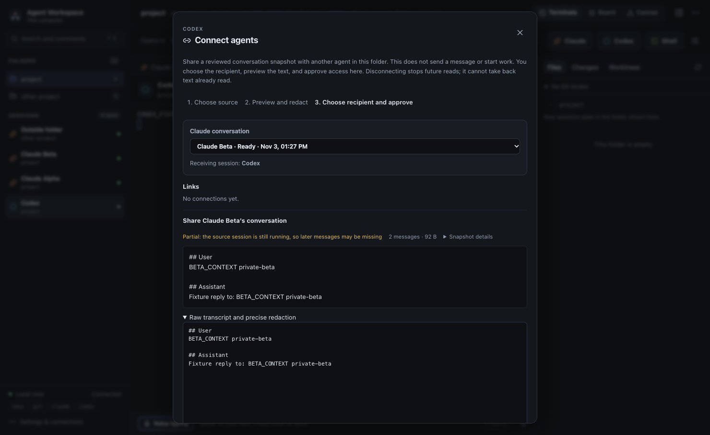

# Claude to Codex connections — 0.4.2

Verified 2026-11-03 on macOS arm64, branch `codex/ux-repair`.

Opening **Connect agents** from Codex previously showed an empty link list and told the owner to find a Claude source on Canvas. The dialog had no source selector, so the visible entry point could not complete the handoff.

The same dialog now contains **Claude conversation**, listing eligible local conversations from the current project. Codex is preselected as the receiving session. A single source is selected automatically; multiple sources are distinguished by title, activity state and start time. Selecting a source does not read or share its transcript. **Preview transcript**, explicit reading consent and **Connect** remain separate actions.

Changing sources clears the old preview, redactions and consent. A preview is bound to the source session, generation, conversation and profile; a changed source identity cannot reuse an older preview. Incoming/outgoing connection history stays anchored to the session that opened the dialog. Existing source-side and Canvas entry points remain available.

After connecting, **Open recipient with instructions → Insert instructions** prepares the reading command in Codex. The owner adds the task and presses Enter. Connections are still snapshots, not live conversation synchronization.

## Verification

- TypeScript and macOS packaging passed.
- Automated suite: **128 total; 126 passed, 0 failed, 2 opt-in skips**.
- New packaged recipient-entry workflow: **5 checks passed**. Empty-source guidance, single-source selection, multiple sources, exclusion of another folder, clearing old review/consent, correct source/recipient identity, minimal read permission, no automatic submission, actual `awctl` read and revocation were exercised.
- Existing packaged accounts/branches/transcript workflow: **10 checks passed**, including profile-specific source sessions, branching, redaction, cross-profile consent, read and revoke.
- The actual installed app was reopened on Codex. Its Connect agents dialog visibly offered both existing Claude conversations and kept Codex as recipient. No private conversation was previewed, connected, granted access or submitted during this check.

The new test uses fixture Claude and Codex programs in a disposable project. The Codex fixture executes the real `awctl transcript read` command after Enter and checks the selected Claude content. This proves delivery and permissions; it does not claim a paid Codex model completed a task. Run it with `npm run verify:transcript-connect`, optionally pointing `WORKSPACE_APP_EXECUTABLE` at the packaged executable. [Machine-readable results](screenshots/transcript-connect/verification.json).

## Installed update

The app was updated to **0.4.2** in the existing app directory, with the previous contents and consistent database backups kept under `release/upgrade-backups/0.4.2-connect/` (ignored by Git).

- Schema remains 9; **all 37 records preserved**.
- **All three live terminal processes retained their original PIDs**, identity, generation and working folder.
- The ZIP's embedded `app.asar` matches the installed archive.
- The unrelated untracked November 3 audit and its ten screenshot files were hash-verified unchanged and excluded from this commit.

| Artifact | SHA-256 |
| --- | --- |
| `release/connect-0.4.2/Agent Workspace-0.4.2-arm64-mac.zip` | `7a685df46c6947d098cf812964261239a61fd44313eee3dadfde5e57be8ca061` |
| Installed `app.asar` | `1a2b2575ead4a7a98ee7a763890a43c59ca1201b2a1c0be386cc38d6ad38ea03` |

