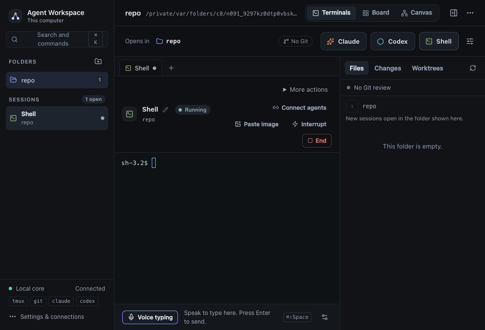
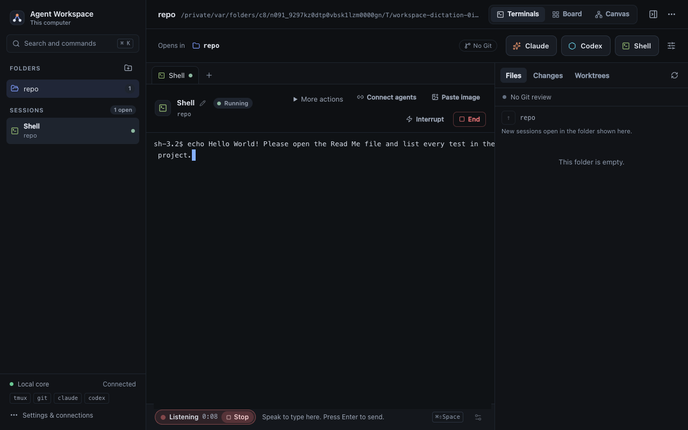
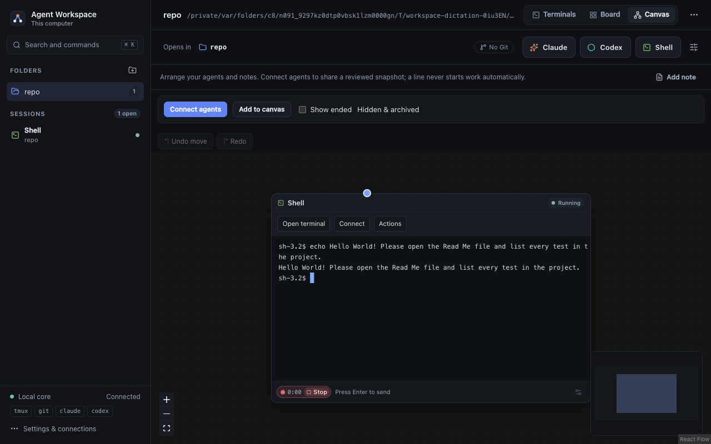

# Voice typing — 0.4.1

Verified on 2026-11-03, macOS arm64, on branch `codex/ux-repair`.

## What changed

The old **Dictate** button shared a crowded session header; Canvas showed only a small microphone icon. Voice settings tested the microphone without providing a clear route back to terminal input.

Every running desktop terminal now has a labeled **Voice typing** bar below its input area, including Canvas cards. It shows the keyboard shortcut, a direct settings button and the instruction to press Enter yourself. Listening shows elapsed time and **Stop**. Starting or stopping from a button returns focus to the terminal, including keyboard activation, so Enter reaches the prompt.

Settings explain the difference between testing the microphone and typing into an AI. A completed microphone test no longer leaves a misleading Stop test button. The dictation shortcut cannot start recording or accidentally activate a focused button inside the settings dialog.

No recognition engine, provider configuration, account credential, remote access permission or data schema changed. Speech remains local, insertion is bound to the original session/generation/viewer, and nothing submits automatically.

## Verification

- TypeScript and production macOS packaging passed.
- Automated suite: **128 tests; 126 passed, 0 failed, 2 opt-in skips**. The move into `010 Projects` exposed unquoted paths in the disposable SSH test launcher; quoting those paths restored both affected checks.
- Packaged speech workflow: **15 checks passed**, including the smallest supported desktop window, settings/shortcut handling, model download and checksum verification, real local transcription, insertion without Enter, keyboard Stop and focus restoration, explicit submission, blur, Canvas, microphone-test completion and switching sessions mid-phrase. See [machine-readable results](screenshots/voice-typing/verification.json).
- Packaged desktop smoke: **9 checks passed**, including typing, crash recovery, cancelled native quit, Canvas and editor saving.
- The actual installed app was reopened and visually checked with the new control beneath the existing Claude prompt.

The speech workflow used the real `sherpa-onnx` tiny.en model and English audio synthesized by macOS `say`. It transcribed: “Hello World! Please open the Read Me file and list every test in the project.” The first check confirmed the text remained at the prompt; only a separate test Enter executed the harmless shell echo.

The packaged Chromium audio-service sandbox refused its fake WAV device file. The macOS test therefore feeds the same WAV as an in-memory MediaStream after the app's real permission check, keeping the sandbox enabled. The speech model, audio processing worklet, phrase segmentation, IPC and terminal insertion remain real. Physical microphone capture, the user's voice and recognition accuracy in noise were not tested; no audio from the user's microphone was recorded during verification. Existing real Claude/Codex sessions received no test input.

## Installed update

Version **0.4.1** was installed into the existing `release/mac-arm64/Agent Workspace.app`, preserving the app directory identity. Consistent database backups and the previous app contents remain in `release/upgrade-backups/0.4.1-voice/` (ignored by Git).

- Schema remains 9.
- **37 records before and after; no records missing.**
- **All three running terminal processes retained their original PIDs.**
- No session identity, generation, folder, backend name or socket changed.
- The ZIP's embedded app archive matches the installed app archive byte for byte.

| Artifact | SHA-256 |
| --- | --- |
| `release/voice-0.4.1/Agent Workspace-0.4.1-arm64-mac.zip` | `c8c15c71d420267a9105dab8139b8bf2c6b938cb851c0251040936621edf5ac2` |
| Installed `app.asar` | `0fc98501227b0e51f13f8bf4989b0c331d82d6c99bc3b1402ceaeef821cf55ac` |

## Screenshots

These are visually checked captures of disposable test sessions, not private user conversations.

